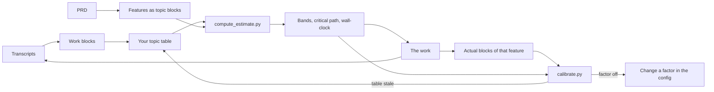

# Estimator

An estimate from your own measured work instead of a gut feeling.

Claude Code already writes a transcript of every session. The estimator cuts those transcripts into work blocks and sorts the blocks by kind of work. Then it measures how long a block of each kind takes you: the median, the p75 and the p95. A PRD then becomes a list of features, each feature a count of blocks per topic. The scripts turn that into hour bands and a wall-clock time.

When a feature is done, you measure it the same way and compare. Every finished feature tells you which part of the estimate was off.

## The loop



Three scripts, one per arrow that matters:

| Script | What it does |
|---|---|
| `refresh_topic_stats.py` | Transcripts to work blocks to your topic table. A filtered run gives the actual blocks of one feature. |
| `compute_estimate.py` | Features to bands per feature, effort, critical path and a capped schedule. Keeps a JSON record of every estimate. |
| `calibrate.py` | Estimate against actual, verdicts per factor once enough features are in, drift between two tables. |

All three are Python 3.9 or newer, standard library only. Nothing is sent anywhere.

## Read in this order

1. [Measuring your own codebase](measuring.md): how transcripts become work blocks, how blocks get a topic, and how many blocks you need before a median means something.
2. [From PRD to estimate](prd-to-estimate.md): features, topic blocks, quality targets, why the output is a band and why effort and wall-clock are different numbers.
3. [Re-measuring and calibrating](calibration.md): recording the actual, reading the ratios, when to change a factor and how to spot drift.
4. [Examples from my measurements](examples.md): a selection of my own measured rows, what they taught me, and two worked estimates you can rerun.

## What it measures

- **Measured:** time inside Claude Code sessions with idle left out, per kind of work.
- **Not measured:** meetings, thinking away from the keyboard, review outside a session. The `overhead` factor covers that time, and calibration tells you whether your factor is right.
- **Not human effort as such.** A turn in which Claude waits on a slow test suite still counts. That is the same definition [timekeeper](https://github.com/Vinix24/claude-code-toolkit/tree/main/timekeeper) uses for active time, and the two tools can check each other.

## Quick start

```bash
git clone https://github.com/Vinix24/claude-code-toolkit
cd claude-code-toolkit/estimator
./install.sh                                   # the skill into ~/.claude/skills/estimator
python3 scripts/refresh_topic_stats.py         # your own table in ~/.claude/estimator/
python3 scripts/compute_estimate.py \
  --features examples/knowledge-base.features.json --project-name "Knowledge base"
```

The first refresh reads every transcript you have, which can take minutes. After that it reads only the transcripts that changed.

Until you have a table of your own, the estimator falls back to `benchmarks.example.md`: one developer's measurements, mine. Every report made from it says so at the top.
